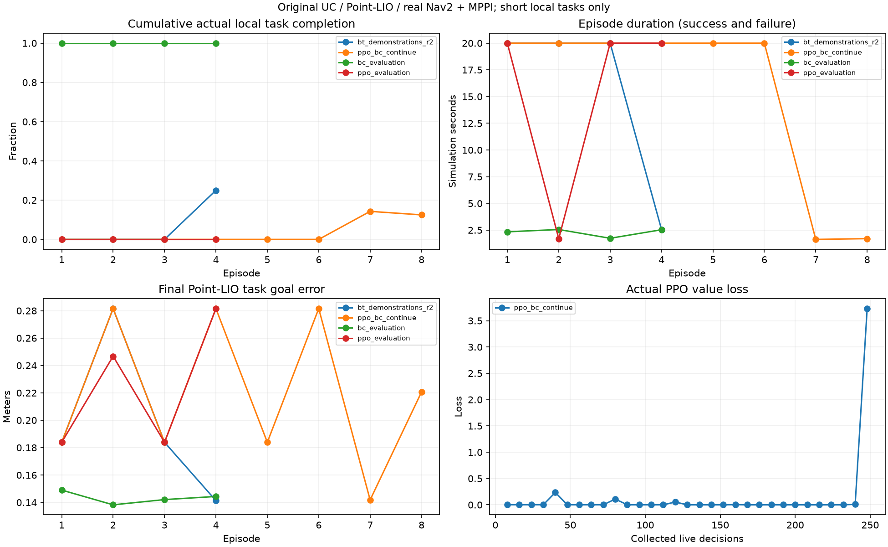
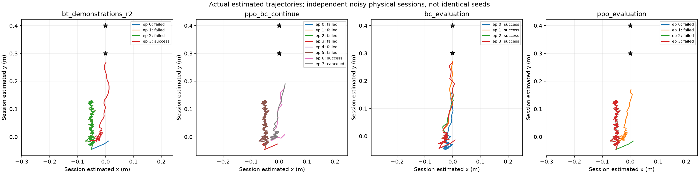

# 实际 Nav2＋MPPI 训练进展

仅统计原始 UC 地图局部工程任务。BT 示范、PPO 训练和 greedy 评估分开报告；这些数字不是比赛胜率。

各组使用相同目标顺序，但物理进程与 Point-LIO 噪声独立，不能解释为相同物理随机种子的配对统计检验。BC 标签准确率仅为训练拟合程度。

| Run | 用途 | 完成 | 平均仿真秒（全部任务） | 实际反馈转移 | PPO 更新 | MPPI 指令（非零） | 证据核验 |
|---|---|---:|---:|---:|---:|---:|---|
| `uc_live_bt_demonstrations_20261117` | BT_training_demonstrations | 1/1；error | 1.755 | 44 | 0 | 48 (47) | 通过 |
| `uc_live_bt_demonstrations_r2_20261117` | BT_training_demonstrations | 1/4 | 15.637 | 128 | 0 | 67 (66) | 通过 |
| `uc_live_ppo_bc_continue_20261117` | PPO_training | 1/8 | 15.416 | 248 | 31 | 120 (119) | 通过 |
| `uc_live_bc_evaluation_20261117` | greedy_evaluation | 4/4 | 2.291 | 21 | 0 | 260 (256) | 通过 |
| `uc_live_ppo_evaluation_20261117` | greedy_evaluation | 0/4 | 15.424 | 125 | 0 | 45 (44) | 通过 |

冻结评估均使用 greedy action，权重未变化且没有 SGD。各评估组进入可执行导航的起点比例不同，当前小样本未控制物理随机性，不能仅据完成数差异推断 PPO 带来提升或退化。

## `uc_live_bt_demonstrations_20261117`

动作计数：`{"navigate": 1, "continue": 3, "hold": 40}`。

完整记录中 1 局至少一次有可执行导航选项，其中完成 1 局；仅 HOLD 合法共 0 步／0.000 s。该可执行子集仅用于定位门禁瓶颈，不替换上表全部任务分母。

实际复制了 2 个物理会话；另有 1 个会话未进入 trainer 完整 episode 列表。上表分母仅为 trainer 完整记录，不能忽略这些异常会话或据此声称全部成功。

## `uc_live_bt_demonstrations_r2_20261117`

动作计数：`{"hold": 122, "navigate": 1, "continue": 5}`。

完整记录中 1 局至少一次有可执行导航选项，其中完成 1 局；仅 HOLD 合法共 122 步／60.000 s。该可执行子集仅用于定位门禁瓶颈，不替换上表全部任务分母。

其中 2 条转移在 action 派发前已进入终态，保留终态反馈但未执行所提议动作。

- episode 0：`failed`；安全停机原因 `{"live_task_time_limit": 1}`；取消原因 `{}`；仅 HOLD 合法 41 步／20.000 s；不支持路径 0 次；非任务点到达 0 次。
  最后足迹诊断：`unknown_support`，cell=`[51, 54]`，普通传感器健康状态=`True`，odom／TF age=`0.10422000000000153`／`0.10422000000000153` s，support／obstacle age=`1.2973999999999997`／`1.2973999999999997` s。

- episode 1：`failed`；安全停机原因 `{"live_task_time_limit": 1}`；取消原因 `{}`；仅 HOLD 合法 40 步／20.000 s；不支持路径 0 次；非任务点到达 0 次。
  最后足迹诊断：`unknown_support`，cell=`[51, 54]`，普通传感器健康状态=`True`，odom／TF age=`0.10422000000000153`／`0.10422000000000153` s，support／obstacle age=`0.7962649999999982`／`0.7962649999999982` s。

- episode 2：`failed`；安全停机原因 `{"live_task_time_limit": 1}`；取消原因 `{}`；仅 HOLD 合法 41 步／20.000 s；不支持路径 0 次；非任务点到达 0 次。
  最后足迹诊断：`unknown_support`，cell=`[51, 54]`，普通传感器健康状态=`True`，odom／TF age=`0.10422000000000153`／`0.10422000000000153` s，support／obstacle age=`0.8999999999999986`／`0.8999999999999986` s。

## `uc_live_ppo_bc_continue_20261117`

动作计数：`{"hold": 240, "navigate": 2, "continue": 6}`。

完整记录中 2 局至少一次有可执行导航选项，其中完成 1 局；仅 HOLD 合法共 240 步／120.000 s。该可执行子集仅用于定位门禁瓶颈，不替换上表全部任务分母。

- episode 0：`failed`；安全停机原因 `{"live_task_time_limit": 1}`；取消原因 `{}`；仅 HOLD 合法 40 步／20.000 s；不支持路径 0 次；非任务点到达 0 次。
  最后足迹诊断：`unknown_support`，cell=`[51, 54]`，普通传感器健康状态=`True`，odom／TF age=`0.10422000000000153`／`0.10422000000000153` s，support／obstacle age=`0.5990049999999982`／`0.5990049999999982` s。

- episode 1：`failed`；安全停机原因 `{"live_task_time_limit": 1}`；取消原因 `{}`；仅 HOLD 合法 40 步／20.000 s；不支持路径 0 次；非任务点到达 0 次。
  最后足迹诊断：`unknown_support`，cell=`[51, 54]`，普通传感器健康状态=`True`，odom／TF age=`0.10422000000000153`／`0.10422000000000153` s，support／obstacle age=`0.7962649999999982`／`0.7962649999999982` s。

- episode 2：`failed`；安全停机原因 `{"live_task_time_limit": 1}`；取消原因 `{}`；仅 HOLD 合法 40 步／20.000 s；不支持路径 0 次；非任务点到达 0 次。
  最后足迹诊断：`unknown_support`，cell=`[51, 54]`，普通传感器健康状态=`True`，odom／TF age=`0.10422000000000153`／`0.10422000000000153` s，support／obstacle age=`0.8999999999999986`／`0.8999999999999986` s。

- episode 3：`failed`；安全停机原因 `{"live_task_time_limit": 1}`；取消原因 `{}`；仅 HOLD 合法 40 步／20.000 s；不支持路径 0 次；非任务点到达 0 次。
  最后足迹诊断：`unknown_support`，cell=`[51, 54]`，普通传感器健康状态=`True`，odom／TF age=`0.10422000000000153`／`0.10422000000000153` s，support／obstacle age=`0.8999999999999986`／`0.8999999999999986` s。

- episode 4：`failed`；安全停机原因 `{"live_task_time_limit": 1}`；取消原因 `{}`；仅 HOLD 合法 40 步／20.000 s；不支持路径 0 次；非任务点到达 0 次。
  最后足迹诊断：`unknown_support`，cell=`[51, 54]`，普通传感器健康状态=`True`，odom／TF age=`0.10422000000000153`／`0.10422000000000153` s，support／obstacle age=`0.7962649999999982`／`0.7962649999999982` s。

- episode 5：`failed`；安全停机原因 `{"live_task_time_limit": 1}`；取消原因 `{}`；仅 HOLD 合法 40 步／20.000 s；不支持路径 0 次；非任务点到达 0 次。
  最后足迹诊断：`unknown_support`，cell=`[51, 54]`，普通传感器健康状态=`True`，odom／TF age=`0.10422000000000153`／`0.10422000000000153` s，support／obstacle age=`0.7962649999999982`／`0.7962649999999982` s。

- episode 7：`canceled`；安全停机原因 `{"localization_invalid": 1}`；取消原因 `{"localization_invalid": 1}`；仅 HOLD 合法 0 步／0.000 s；不支持路径 0 次；非任务点到达 0 次。
  最后足迹诊断：`unknown_support`，cell=`[56, 56]`，普通传感器健康状态=`True`，odom／TF age=`0.1049199999999999`／`0.1049199999999999` s，support／obstacle age=`0.4953650000000005`／`0.4953650000000005` s。
  generic `localization_invalid` 同时覆盖足迹支撑门禁，不能据此认定 Point-LIO 失效。

BC 训练拟合记录：

```json
{
  "updates": 200,
  "actor_only": true,
  "learning_rate": 0.001,
  "balanced_represented_classes": true,
  "mean_loss": 0.19283148251473903,
  "training_label_accuracy": 1.0,
  "original_label_counts_and_accuracy": {
    "navigate": {
      "count": 1,
      "accuracy": 1.0
    },
    "recover": {
      "count": 0,
      "accuracy": null
    },
    "continue": {
      "count": 5,
      "accuracy": 1.0
    },
    "hold": {
      "count": 122,
      "accuracy": 1.0
    }
  }
}
```

31 次 PPO 更新中 30 次 rollout 全是单一合法动作；累计只有 8 条转移含多选项。单一动作 categorical 的 actor policy gradient 为零，此时 actor 变化可能来自显式 BC 辅助项，不能据权重变化声称 PPO 已改善导航。

## `uc_live_bc_evaluation_20261117`

动作计数：`{"hold": 1, "navigate": 4, "continue": 16}`。

完整记录中 4 局至少一次有可执行导航选项，其中完成 4 局；仅 HOLD 合法共 1 步／0.500 s。该可执行子集仅用于定位门禁瓶颈，不替换上表全部任务分母。

## `uc_live_ppo_evaluation_20261117`

动作计数：`{"hold": 121, "navigate": 1, "continue": 3}`。

完整记录中 1 局至少一次有可执行导航选项，其中完成 0 局；仅 HOLD 合法共 121 步／60.000 s。该可执行子集仅用于定位门禁瓶颈，不替换上表全部任务分母。

其中 1 条转移在 action 派发前已进入终态，保留终态反馈但未执行所提议动作。

- episode 0：`failed`；安全停机原因 `{"live_task_time_limit": 1}`；取消原因 `{}`；仅 HOLD 合法 41 步／20.000 s；不支持路径 0 次；非任务点到达 0 次。
  最后足迹诊断：`unknown_support`，cell=`[51, 54]`，普通传感器健康状态=`True`，odom／TF age=`0.10422000000000153`／`0.10422000000000153` s，support／obstacle age=`0.7962649999999982`／`0.7962649999999982` s。

- episode 1：`failed`；安全停机原因 `{"navigation_terminal_failed": 1}`；取消原因 `{}`；仅 HOLD 合法 0 步／0.000 s；不支持路径 0 次；非任务点到达 0 次。
  最后足迹诊断：`unknown_support`，cell=`[57, 56]`，普通传感器健康状态=`True`，odom／TF age=`0.09989999999999988`／`0.09989999999999988` s，support／obstacle age=`0.49441999999999986`／`0.49441999999999986` s。
  实际 controller 错误：`[ERROR] [1794905558.144904057] [rl_bt_nav_probe.controller_server]: Optimizer fail to compute path`。

- episode 2：`failed`；安全停机原因 `{"live_task_time_limit": 1}`；取消原因 `{}`；仅 HOLD 合法 40 步／20.000 s；不支持路径 0 次；非任务点到达 0 次。
  最后足迹诊断：`unknown_support`，cell=`[51, 54]`，普通传感器健康状态=`True`，odom／TF age=`0.10422000000000153`／`0.10422000000000153` s，support／obstacle age=`1.2973999999999997`／`1.2973999999999997` s。

- episode 3：`failed`；安全停机原因 `{"live_task_time_limit": 1}`；取消原因 `{}`；仅 HOLD 合法 40 步／20.000 s；不支持路径 0 次；非任务点到达 0 次。
  最后足迹诊断：`unknown_support`，cell=`[51, 54]`，普通传感器健康状态=`True`，odom／TF age=`0.10422000000000153`／`0.10422000000000153` s，support／obstacle age=`0.8999999999999986`／`0.8999999999999986` s。

实际运行链路由复制的 controller 插件日志、原图 hash、observed 支撑、GT 关闭与 RPC 转移共同核验；命令数只计 fixture 实际记录。

checkpoint／源代码 hash、逐局安全停机事件和估计轨迹来源见 `comparison.json`。

图仅展示完整批次；中断首尝试保留在上表及异常会话证据中。




