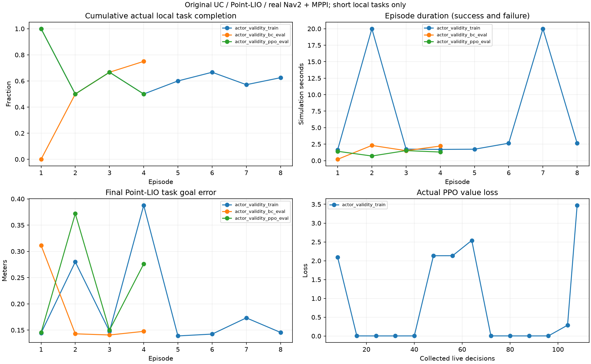
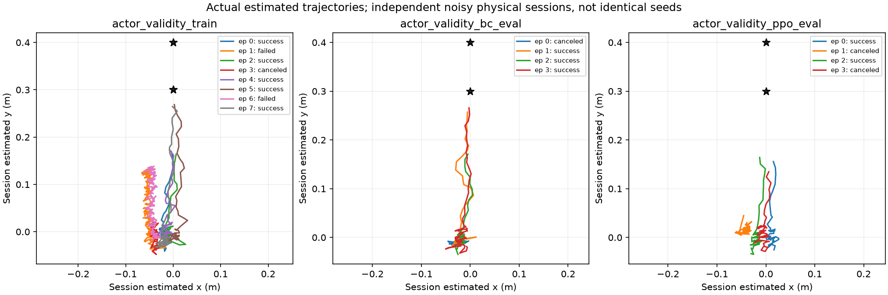

# 实际 Nav2＋MPPI 训练进展

仅统计原始 UC 地图局部工程任务。BT 示范、PPO 训练和 greedy 评估分开报告；这些数字不是比赛胜率。

各组使用相同目标顺序，逐局sensor seed见下文；物理进程、传感器队列与估计器调度并非严格配对，不能解释为完全相同物理随机过程的统计检验。BC 标签准确率仅为训练拟合程度。

| Run | 用途 | 完成 | 平均仿真秒（全部任务） | 实际反馈转移 | PPO 更新 | MPPI 指令（非零） | 证据核验 |
|---|---|---:|---:|---:|---:|---:|---|
| `uc_live_actor_validity_train_20261117` | PPO_training | 5/8 | 6.511 | 108 | 14 | 310 (305) | 通过 |
| `uc_live_actor_validity_bc_eval_20261117` | greedy_evaluation | 3/4 | 1.556 | 15 | 0 | 439 (436) | 通过 |
| `uc_live_actor_validity_ppo_eval_20261117` | greedy_evaluation | 2/4 | 1.234 | 12 | 0 | 225 (223) | 通过 |

冻结评估均使用 greedy action，权重未变化且没有 SGD。uc_live_actor_validity_bc_eval_20261117：4/4局存在可执行导航选项；uc_live_actor_validity_ppo_eval_20261117：4/4局存在可执行导航选项。当前小样本的物理调度未严格配对，不能仅据完成数差异推断 PPO 带来提升或退化。

## `uc_live_actor_validity_train_20261117`

动作计数：`{"navigate": 7, "continue": 19, "hold": 82}`。

完整记录中 6 局至少一次有可执行导航选项，其中完成 5 局；仅 HOLD 合法共 82 步／41.000 s。该可执行子集仅用于定位门禁瓶颈，不替换上表全部任务分母。

- episode 1：`failed`；安全停机原因 `{"live_task_time_limit": 1}`；取消原因 `{}`；仅 HOLD 合法 40 步／20.000 s；不支持路径 0 次；非任务点到达 0 次。
  最后足迹诊断：`unknown_support`，cell=`[51, 54]`，普通传感器健康状态=`True`，odom／TF age=`0.10422000000000153`／`0.10422000000000153` s，support／obstacle age=`1.2973999999999997`／`1.2973999999999997` s。

- episode 3：`canceled`；安全停机原因 `{"localization_invalid": 1}`；取消原因 `{"localization_invalid": 1}`；仅 HOLD 合法 2 步／1.000 s；不支持路径 0 次；非任务点到达 0 次。
  最后足迹诊断：`unknown_support`，cell=`[51, 53]`，普通传感器健康状态=`True`，odom／TF age=`0.10484000000000027`／`0.10484000000000027` s，support／obstacle age=`0.9997850000000001`／`0.9997850000000001` s。
  generic `localization_invalid` 同时覆盖足迹支撑门禁，不能据此认定 Point-LIO 失效。

- episode 6：`failed`；安全停机原因 `{"live_task_time_limit": 1}`；取消原因 `{}`；仅 HOLD 合法 40 步／20.000 s；不支持路径 0 次；非任务点到达 0 次。
  最后足迹诊断：`unknown_support`，cell=`[51, 54]`，普通传感器健康状态=`True`，odom／TF age=`0.10422000000000153`／`0.10422000000000153` s，support／obstacle age=`0.7962649999999982`／`0.7962649999999982` s。

BC 训练拟合记录：

```json
{
  "updates": 200,
  "actor_only": true,
  "learning_rate": 0.001,
  "balanced_represented_classes": true,
  "mean_loss": 0.19283148251473903,
  "training_label_accuracy": 1.0,
  "original_label_counts_and_accuracy": {
    "navigate": {
      "count": 1,
      "accuracy": 1.0
    },
    "recover": {
      "count": 0,
      "accuracy": null
    },
    "continue": {
      "count": 5,
      "accuracy": 1.0
    },
    "hold": {
      "count": 122,
      "accuracy": 1.0
    }
  }
}
```

实际 actor／critic 学习计数（actor 梯度与 anchor 分开记录）：

```json
{
  "on_policy_actor_sample_count": 26,
  "actor_excluded_not_applied_count": 0,
  "actor_excluded_applied_single_choice_count": 82,
  "actor_optimizer_steps": 28,
  "critic_optimizer_steps": 28,
  "anchor_only_actor_optimizer_steps": 16
}
```

声明 sensor noise seeds：`[31000, 31001, 31002, 31003, 31004, 31005, 31006, 31007]`。已逐局核对fixture；相同sensor seed不保证相同物理调度、Point-LIO或MPPI随机轨迹。

14 次 PPO 更新中 8 次 rollout 全是单一合法动作；累计只有 26 条转移含多选项。单一动作 categorical 的 actor policy gradient 为零，此时 actor 变化可能来自显式 BC 辅助项，不能据权重变化声称 PPO 已改善导航。

## `uc_live_actor_validity_bc_eval_20261117`

动作计数：`{"navigate": 4, "continue": 11}`。

完整记录中 4 局至少一次有可执行导航选项，其中完成 3 局；仅 HOLD 合法共 0 步／0.000 s。该可执行子集仅用于定位门禁瓶颈，不替换上表全部任务分母。

- episode 0：`canceled`；安全停机原因 `{"localization_invalid": 1}`；取消原因 `{"localization_invalid": 1}`；仅 HOLD 合法 0 步／0.000 s；不支持路径 0 次；非任务点到达 0 次。
  最后足迹诊断：`unknown_support`，cell=`[51, 54]`，普通传感器健康状态=`True`，odom／TF age=`0.10130000000000017`／`0.10130000000000017` s，support／obstacle age=`1.4973400000000003`／`1.4973400000000003` s。
  generic `localization_invalid` 同时覆盖足迹支撑门禁，不能据此认定 Point-LIO 失效。

实际 actor／critic 学习计数（actor 梯度与 anchor 分开记录）：

```json
{
  "on_policy_actor_sample_count": 0,
  "actor_excluded_not_applied_count": 0,
  "actor_excluded_applied_single_choice_count": 0,
  "actor_optimizer_steps": 0,
  "critic_optimizer_steps": 0,
  "anchor_only_actor_optimizer_steps": 0
}
```

声明 sensor noise seeds：`[41000, 41001, 41002, 41003]`。已逐局核对fixture；相同sensor seed不保证相同物理调度、Point-LIO或MPPI随机轨迹。

## `uc_live_actor_validity_ppo_eval_20261117`

动作计数：`{"navigate": 4, "continue": 7, "hold": 1}`。

完整记录中 4 局至少一次有可执行导航选项，其中完成 2 局；仅 HOLD 合法共 1 步／0.500 s。该可执行子集仅用于定位门禁瓶颈，不替换上表全部任务分母。

- episode 1：`canceled`；安全停机原因 `{"localization_invalid": 1}`；取消原因 `{"localization_invalid": 1}`；仅 HOLD 合法 1 步／0.500 s；不支持路径 0 次；非任务点到达 0 次。
  最后足迹诊断：`unknown_support`，cell=`[51, 53]`，普通传感器健康状态=`True`，odom／TF age=`0.1024799999999999`／`0.1024799999999999` s，support／obstacle age=`0.799995`／`0.799995` s。
  generic `localization_invalid` 同时覆盖足迹支撑门禁，不能据此认定 Point-LIO 失效。

- episode 3：`canceled`；安全停机原因 `{"localization_invalid": 1}`；取消原因 `{"localization_invalid": 1}`；仅 HOLD 合法 0 步／0.000 s；不支持路径 0 次；非任务点到达 0 次。
  最后足迹诊断：`unknown_support`，cell=`[56, 56]`，普通传感器健康状态=`True`，odom／TF age=`0.10505999999999993`／`0.10505999999999993` s，support／obstacle age=`0.5998049999999999`／`0.5998049999999999` s。
  generic `localization_invalid` 同时覆盖足迹支撑门禁，不能据此认定 Point-LIO 失效。

实际 actor／critic 学习计数（actor 梯度与 anchor 分开记录）：

```json
{
  "on_policy_actor_sample_count": 0,
  "actor_excluded_not_applied_count": 0,
  "actor_excluded_applied_single_choice_count": 0,
  "actor_optimizer_steps": 0,
  "critic_optimizer_steps": 0,
  "anchor_only_actor_optimizer_steps": 0
}
```

声明 sensor noise seeds：`[41000, 41001, 41002, 41003]`。已逐局核对fixture；相同sensor seed不保证相同物理调度、Point-LIO或MPPI随机轨迹。

实际运行链路由复制的 controller 插件日志、原图 hash、observed 支撑、GT 关闭与 RPC 转移共同核验；命令数只计 fixture 实际记录。

checkpoint／源代码 hash、逐局安全停机事件和估计轨迹来源见 `comparison.json`。

图仅展示完整批次；中断首尝试保留在上表及异常会话证据中。




