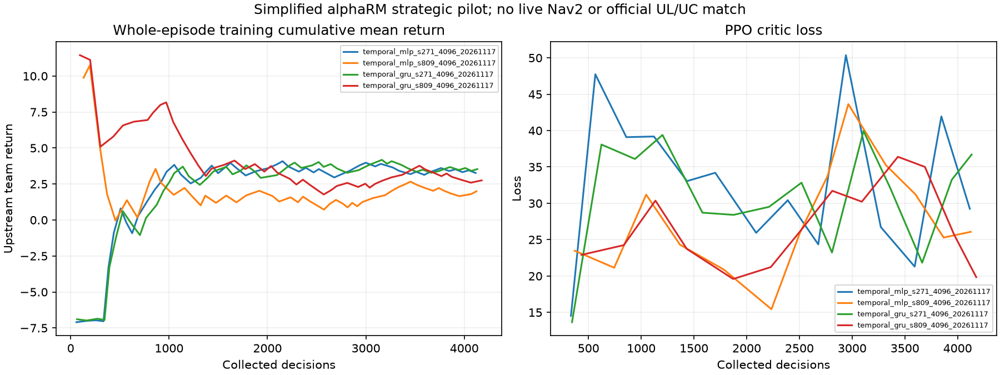

# 时序与全局任务决策 pilot

本报告使用已保存的alphaRM简化3v3完整回合；不是正式UL／UC比赛，也未在该环境调用真实Nav2／MPPI。真实导航结果仍单独保存。

比较MLP PPO、GRU PPO、reactive BT、带内部状态的Python BT基线，以及GRU每步清空隐藏状态的消融。PPO是训练算法，历史利用能力来自状态设计／循环记忆；不预设优于BT。

| Run | Memory | 实际交互 | 完整局数 | 状态 |
|---|---|---:|---:|---|
| `temporal_mlp_s271_4096_20261117` | mlp | 4116 | 56 | complete |
| `temporal_mlp_s809_4096_20261117` | mlp | 4124 | 51 | complete |
| `temporal_gru_s271_4096_20261117` | gru | 4133 | 55 | complete |
| `temporal_gru_s809_4096_20261117` | gru | 4177 | 50 | complete |

学习有效性（强制单选不计直接actor loss，仍保留时序和critic；参数变化不等于策略收益）：

| Run | actor有效决策 | 强制单选 | actor参数变化L2 | 单有效样本更新数 |
|---|---:|---:|---:|---:|
| `temporal_mlp_s271_4096_20261117` | 2920 | 1196 | 0.374989 | 0 |
| `temporal_mlp_s809_4096_20261117` | 2828 | 1296 | 0.363948 | 0 |
| `temporal_gru_s271_4096_20261117` | 2859 | 1274 | 0.509824 | 0 |
| `temporal_gru_s809_4096_20261117` | 2951 | 1226 | 0.537275 | 0 |

实际时间覆盖：

| Run | 累计仿真秒数 | 每局最短—最长秒数 |
|---|---:|---:|
| `temporal_mlp_s271_4096_20261117` | 2047.7 | 25.0—65.4 |
| `temporal_mlp_s809_4096_20261117` | 2050.3 | 22.7—68.0 |
| `temporal_gru_s271_4096_20261117` | 2054.8 | 23.4—83.2 |
| `temporal_gru_s809_4096_20261117` | 2078.8 | 22.5—69.6 |

固定测试结果（每个checkpoint独立列出，未用测试挑选模型）：

| Policy | 胜／完整局 | 平局 | 平均团队回报 | 平均换点 |
|---|---:|---:|---:|---:|
| `bt_reactive` | 8/8 | 0 | 11.375 | 3.75 |
| `bt_memory` | 8/8 | 0 | 11.060 | 5.62 |
| `mlp_s271` | 8/8 | 0 | 10.656 | 1.12 |
| `mlp_s809` | 8/8 | 0 | 11.012 | 1.12 |
| `gru_s271` | 8/8 | 0 | 11.073 | 0.00 |
| `gru_s271_reset` | 8/8 | 0 | 11.073 | 0.00 |
| `gru_s809` | 8/8 | 0 | 10.656 | 1.12 |
| `gru_s809_reset` | 8/8 | 0 | 10.656 | 1.12 |

分风格结果：

| Policy | capture 胜/局 | pursuit（训练未见）胜/局 |
|---|---:|---:|
| `bt_reactive` | 4/4 | 4/4 |
| `bt_memory` | 4/4 | 4/4 |
| `mlp_s271` | 4/4 | 4/4 |
| `mlp_s809` | 4/4 | 4/4 |
| `gru_s271` | 4/4 | 4/4 |
| `gru_s271_reset` | 4/4 | 4/4 |
| `gru_s809` | 4/4 | 4/4 |
| `gru_s809_reset` | 4/4 | 4/4 |

整局行为诊断（占比为决策后采样估计，不是连续真值积分）：

| Policy | 平均实际局长s | 存活占比 | 中心占比 | 自身伤害/全队伤害 | BT覆盖/决策 |
|---|---:|---:|---:|---:|---:|
| `bt_reactive` | 26.8 | 0.882 | 0.510 | 0.295 | 0.116 |
| `bt_memory` | 29.6 | 0.825 | 0.485 | 0.259 | 0.174 |
| `mlp_s271` | 33.3 | 0.815 | 0.000 | 0.169 | 0.184 |
| `mlp_s809` | 30.4 | 0.854 | 0.000 | 0.214 | 0.145 |
| `gru_s271` | 33.3 | 1.000 | 0.000 | 0.095 | 0.000 |
| `gru_s271_reset` | 33.3 | 1.000 | 0.000 | 0.095 | 0.000 |
| `gru_s809` | 33.3 | 0.815 | 0.000 | 0.169 | 0.184 |
| `gru_s809_reset` | 33.3 | 0.815 | 0.000 | 0.169 | 0.184 |

同一GRU权重的记忆消融（携带hidden减去每步清零，正值代表携带记忆较高）：

| 模型 | 胜率差 | 团队回报差 | 配对场景数 |
|---|---:|---:|---:|
| `gru_s271` | +0.000 | +0.000 | 8 |
| `gru_s809` | +0.000 | +0.000 | 8 |

相同记录观测的记忆检查（第一测试场景，carried回放须逐步复现原动作）：

| GRU | 观测数 | 携带与清零的greedy动作差异数 |
|---|---:|---:|
| `gru_s271` | 71 | 0 |
| `gru_s809` | 73 | 0 |

相同记录观测的学习前后检查（不用于模型选择或胜率归因）：

| 模型 | 观测数 | initial与final的greedy差异数 | 平均KL(initial→final) |
|---|---:|---:|---:|
| `mlp_s271` | 73 | 52 | 0.000078 |
| `mlp_s809` | 52 | 41 | 0.000027 |
| `gru_s271` | 71 | 0 | 0.000098 |
| `gru_s809` | 73 | 52 | 0.000200 |

两个训练seed和两个测试扰动seed只是小规模工程pilot。部分对手风格、双方阵营在同一seed下相关；均值差不能独立证明收敛、实战优势或普适优于BT。详细分风格、记忆消融及原始结果见evaluation目录。

gamma按实际秒折扣.997：180秒后的折扣约.582；lambda按秒.97，二者相乘的GAE trace半衰期约20.7秒，180秒后的trace约.00242。折扣视野不等于实际优势归因视野。GRU采用时间顺序训练、episode重置，仍不能保证记住整局或取得最佳全局策略。

MLP共有55,490参数，GRU共有113,474参数，二者容量不相同。每步清零消融保持权重相同，但会改变GRU输入的hidden分布；它用于检查模型对历史的依赖，不能单独证明模型学会了长周期全局规划。

复用上游冻结的env_step.onnx、actor.onnx（其他机器人／固定技能）、fixture和旧观测／候选／执行器；本轮未复用历史checkpoint、BC标签或测试数据进行训练。买血买弹与正式UL/UC共享经济不在该不可变简化环境内。

每局最长180秒，但可按上游胜负条件提前结束；完整回合不等于必定经历180秒。团队中另两台机器人使用固定上游策略，团队胜负同时受其影响，不能将单局胜利全部归功于待测选点模型。

